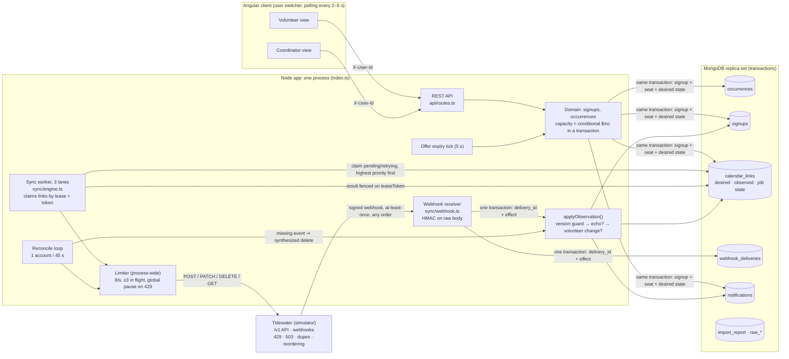
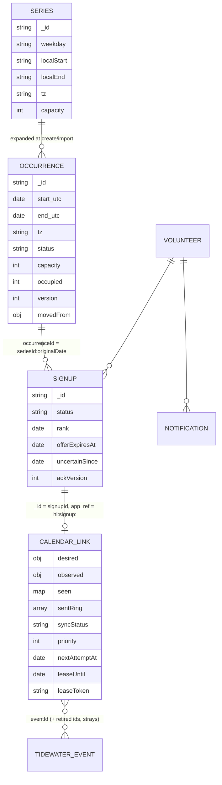

# Architecture

Everything below exists in the code unless it's under **"To production"**. File references are relative to `app-skeleton/server/src/`.

## System and both sync directions

**Outbound.** Domain code never calls Tidewater. Whenever a signup or occurrence changes, the same transaction recomputes that signup's `calendar_links.desired` (`{present, start, end, title}`) and marks it `pending`, with a priority: coordinator 10, volunteer 5, backfill 0. The worker compares desired with observed and picks one call:
- **POST** when the event should exist and doesn't.
- **PATCH** with start and end only, when it exists at the wrong time. The volunteer owns the title.
- **DELETE** when it exists but shouldn't.

The worker records the response, then re-checks against the *current* desired state, which may have changed while the call was in flight.

**Inbound.** A webhook, or a reconcile finding, goes through `applyObservation`:
1. **Ownership.** If the `app_ref` isn't ours, ignore it.
2. **Version guard.** A conditional update on `seen[eventId] < version`. Duplicates and late (reordered) deliveries stop here.
3. **In flight.** If we have a write in flight for this link, park the observation and decide after our response arrives. The webhook for our own write can beat the HTTP response back.
4. **Converged.** If observed equals desired, it's our echo or a no-op.
5. **Stale echo.** If it matches a shape we sent recently, re-check.
6. **Volunteer change.** Otherwise the volunteer changed it:
   - **Delete:** the signup becomes `uncertain`, the volunteer is notified, and the seat is kept.
   - **Time edit:** the link becomes `drift`, and the coordinator can re-push.

## Data model

- **Occurrences are materialized documents.** Their id is `(seriesId, originalDate)`, so moving one changes only its `start`/`end`/`version`. Signups keep pointing at it, and nothing else in the series changes.
- **Signup statuses:**
  - `confirmed`, `offered` and `uncertain` hold a seat (counted in `occupied`).
  - `waitlisted` doesn't.
  - `cancelled` and `cancelled_by_org` are terminal.
  - A partial unique index allows one active signup per volunteer per occurrence.
- **Capacity is enforced in exactly one place.** `takeSeat()` runs `findOneAndUpdate({occupied < capacity, status: scheduled}, {$inc: {occupied: 1}})` inside the same `withTransaction` as the signup write. A seat is released only when a conditional status transition actually matched.
- **`calendar_links` is the job queue.** No separate outbox: the link holds the desired state, attempt count, backoff and lease. Because the worker always converges to the *latest* desired state, three quick moves are one PATCH, not three.

## Failure handling (what's built)

| Provider behaviour | Response |
|---|---|
| 429 + Retry-After | The whole limiter pauses. Not counted as an attempt. |
| 503 / network error | Exponential backoff with jitter, capped at 60 s. Status `retrying`, with the error shown in the roster. Never silently "synced". |
| Timeout on POST (may have applied) | Before re-creating, GET the account's events and adopt by `app_ref`. Extra copies become `strays` and are deleted. |
| 404 on PATCH | The volunteer deleted it first; same path as a delete webhook. |
| 404 on DELETE | Success. |
| Other 4xx | `failed`, with a manual retry button. |
| Duplicate delivery | The `delivery_id` row is written in the same transaction as the effect. A concurrent duplicate gets a write conflict → 503 → the provider retries → sees the duplicate → 200. |
| Out-of-order delivery | Per-event version guard. Old event ids (after a re-add) are kept in `retiredEventIds`. |
| Webhooks lost after the provider's retries | The reconcile loop lists accounts and synthesizes the missing delete. |

## To production: 50 nonprofits, 20,000 volunteers

Not built. This is what changes, in the order it would bite.

1. **Tenancy.** Add `orgId` to every collection and index. Tidewater credentials become per-org (and, with real providers, per-volunteer OAuth tokens in a secrets store, never in Mongo documents).
2. **The queue moves out of Mongo polling.** `calendar_links` stays the source of truth for desired and observed state. "This link is dirty" becomes a message on a broker (SQS, or Redis Streams), partitioned by **provider account**, so one volunteer's calls stay ordered and a hot org can't starve the others. Workers scale horizontally; the lease/token fencing already in the code is what makes that safe.
3. **The rate limiter moves to Redis.** A token bucket keyed per provider account and per provider app, shared by all workers. Today's process-local limiter is the first thing that breaks with a second instance. Org-level fairness is weighted round-robin across partitions.
4. **Webhook ingestion splits from processing.** The receiver verifies the signature, writes `delivery_id` + raw payload, returns 200, and enqueues. A consumer runs `applyObservation`. That keeps the endpoint fast under bursts (the simulator times out at 5 s). The current single-transaction design stays the consumer's logic.
5. **Reconcile becomes incremental.** Use provider sync tokens / `updated_since` where they exist. Prioritize accounts with upcoming shifts. Sweep everyone daily rather than hourly.
6. **Fan-out for a move.** A move touching 500 volunteers enqueues 500 link jobs at coordinator priority. The coordinator UI reads aggregate counts (synced / retrying / failed / not connected) from a materialized per-occurrence summary instead of scanning links.
7. **Observability.**
   - **Traces:** OpenTelemetry on API → transaction → link job → provider call → webhook → applyObservation, with `signupId`/`linkId` as attributes.
   - **Metrics:** queue depth and age by priority; provider 429/503 rates per account; time-to-converge after a move (p50/p95); count of `uncertain` and `drift`.
   - **Alerts:** the audit's **dishonest count** runs as a scheduled job and pages if it is ever > 0.
8. **Notifications** become their own service with per-volunteer channels and quiet hours (the mockup). The offer-hold clock already uses the same quiet-hour rule.
